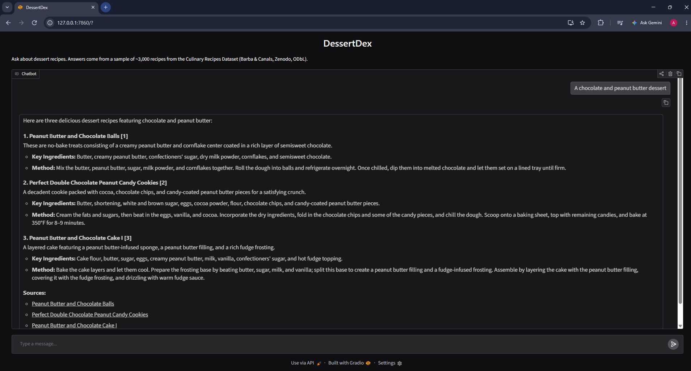

# DessertDex 🍰

A dessert recipe assistant built with retrieval-augmented generation (RAG). Ask for desserts in natural language ("something with apples and cinnamon", "chocolate and peanut butter") and get answers grounded in real recipes, each with a link back to its source.

**Live demo:** _add your Hugging Face Space link here_



## What it does

- Searches a collection of 3,000 dessert recipes by meaning, not just keywords.
- Answers in a short, readable summary and cites the recipes it used (`[1]`, `[3]`).
- Says "I don't have a matching recipe" when nothing relevant is found, instead of inventing one.
- Links every answer to the original recipe page and credits the recipe author.

## How it works

```
question
   │
   ▼
embed question (all-MiniLM-L6-v2) ──► FAISS similarity search (top 4)
   │                                          │
   │                       score below 0.50? ─┴─► "no matching recipe"
   ▼
prompt = rules + retrieved recipes + question
   │
   ▼
Gemini (free tier) ──► answer with numbered citations ──► Gradio chat UI + source links
```

| Component | Choice |
|---|---|
| Embeddings | `sentence-transformers/all-MiniLM-L6-v2` (runs on CPU) |
| Vector search | FAISS (`IndexFlatIP` on normalized vectors = cosine similarity) |
| LLM | Gemini Flash-Lite via the Google AI Studio free tier |
| UI | Gradio |
| Data | Culinary Recipes Dataset, filtered to desserts |

## Design decisions

- **One recipe = one chunk.** The embedding model reads only about 256 tokens, so I embed a short "search card" per recipe (name, cuisine, ingredients) and keep the full recipe text for the prompt. Users search by ingredients, so this fits how people ask.
- **Two layers against made-up answers.** A similarity threshold (0.50) filters out clearly off-topic questions, and the prompt tells the model to refuse when the retrieved recipes don't answer the question. The threshold alone can't tell "a dessert we don't have" from "one we do", so the prompt rule is needed too.
- **Paraphrase and cite.** The model summarizes in its own words, uses only the retrieved recipes, and always shows source links.
- **Prompt-injection hygiene.** Retrieved text is labeled as data, and the system prompt tells the model to ignore instructions inside it.

## Evaluation

I wrote a small test set (`eval_set.json`) of dessert queries and off-topic queries. A result counts as relevant if its name or ingredients contain all the expected terms. Off-topic queries should score below the threshold.

| Version | Precision@5 | Top-1 relevant | Correct refusals |
|---|---|---|---|
| Baseline (threshold 0.30, duplicates in data) | 0.91 | 8/9 | 1/3 |
| Threshold 0.50, 565 duplicate recipes removed | 0.87 | 9/9 | 7/8 |

Notes on these numbers:

- Removing duplicates lowered precision because duplicate copies of a relevant recipe had been counting as extra hits. The lower number is the honest one.
- The one "failed refusal" was a mislabeled test ("how to make pudding" is a valid dessert question). I corrected the label afterwards.
- The threshold was tuned on a small set of queries I wrote myself, so treat these results as indicative, not as a benchmark.
- This evaluates retrieval only. I spot-checked answer faithfulness by hand against the source recipes; I haven't built an automated check for it.

## Limitations

- The source data is not perfect. For example, one recipe lists baking soda in the ingredients but baking powder in the steps. Always check the linked original.
- Search is based on ingredients and names, so queries about method (like "no-bake") work less well.
- Only 3,000 desserts are indexed, so many dishes (for example knafeh or brigadeiro) are missing, and the app should say so.
- The free LLM tier has rate limits, and free-tier requests may be used by the provider to improve its products. Don't type private information.
- Not a substitute for checking allergens or food-safety details on the original recipe.

## Run it locally

Requires Python 3.10+.

```bash
git clone https://github.com/ahmadanka1/dessertdex.git
cd dessertdex

python -m venv .venv
# Windows: .venv\Scripts\activate      Mac/Linux: source .venv/bin/activate

pip install -r requirements.txt
cp .env.example .env        # then add your key (Windows: copy .env.example .env)
```

Get a free API key at [Google AI Studio](https://aistudio.google.com) and put it in `.env`:

```
GEMINI_API_KEY=your_key_here
GEMINI_MODEL=gemini-3.1-flash-lite
```

Model names and free-tier availability change; check AI Studio for what is currently available.

Start the app (the processed recipes and search index are already in `data/`):

```bash
python app.py
```

### Rebuild the data from scratch (optional)

```bash
python src/download_data.py   # downloads the 110 MB source CSV from Zenodo
python src/prepare_data.py    # filters to desserts, cleans, de-duplicates, samples 3,000
python src/ingest.py          # builds the FAISS index
python src/evaluate.py        # runs the evaluation
```

`data/index.faiss` only matches the exact `data/desserts.jsonl` it was built from. If you re-run `prepare_data.py`, re-run `ingest.py` too.

## Project structure

```
dessertdex/
├── app.py                 # Gradio chat UI
├── src/
│   ├── download_data.py   # fetch the source CSV (not stored in this repo)
│   ├── prepare_data.py    # filter, clean, de-duplicate, sample
│   ├── ingest.py          # embed recipes and build the FAISS index
│   ├── search.py          # similarity search
│   ├── generate.py        # prompt building and Gemini call
│   └── evaluate.py        # retrieval evaluation
├── data/
│   ├── desserts.jsonl     # processed sample of 3,000 recipes
│   └── index.faiss        # search index built from desserts.jsonl
├── eval_set.json
├── requirements.txt
└── .env.example
```

## Data and attribution

The recipes come from the **Culinary Recipes Dataset**:

> Barba, P., & Canals, N. (2025). *Culinary Recipes Dataset* (Version v1) [Data set]. Zenodo. https://doi.org/10.5281/zenodo.15169428

- The dataset is licensed under the [Open Database License (ODbL) v1.0](http://www.opendatacommons.org/licenses/odbl/1.0/). The processed files in `data/` (`desserts.jsonl` and the index built from it) are a derived database and are shared under the same ODbL v1.0 license, with the same attribution.
- The recipe records in the dataset link to [Allrecipes](https://www.allrecipes.com). The recipe text, names and ingredient lists belong to their original authors and publisher. Each recipe in this project keeps its source URL and author name, and the app links back to the original page with every answer.
- The full source CSV is not included in this repository; download it from the Zenodo link above.
- This project is a personal portfolio and learning project. It is not affiliated with or endorsed by Allrecipes or the dataset authors. If you are a rights holder and want a recipe removed, please open an issue on this repository.

## License

The code is released under the MIT License (see `LICENSE`). The data in `data/` is covered by the ODbL license described above, not by the MIT License.